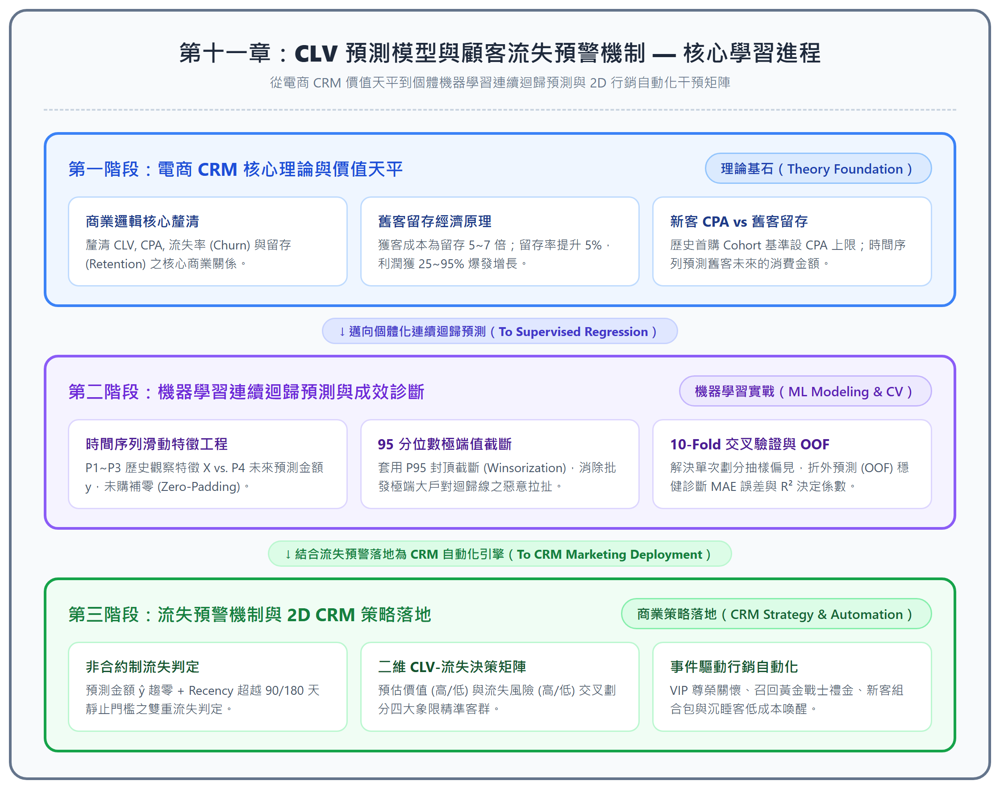
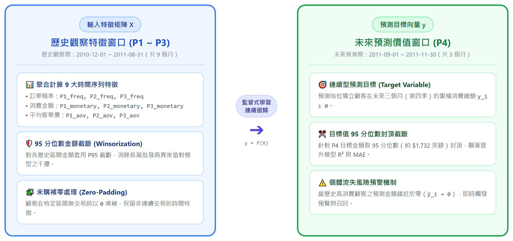
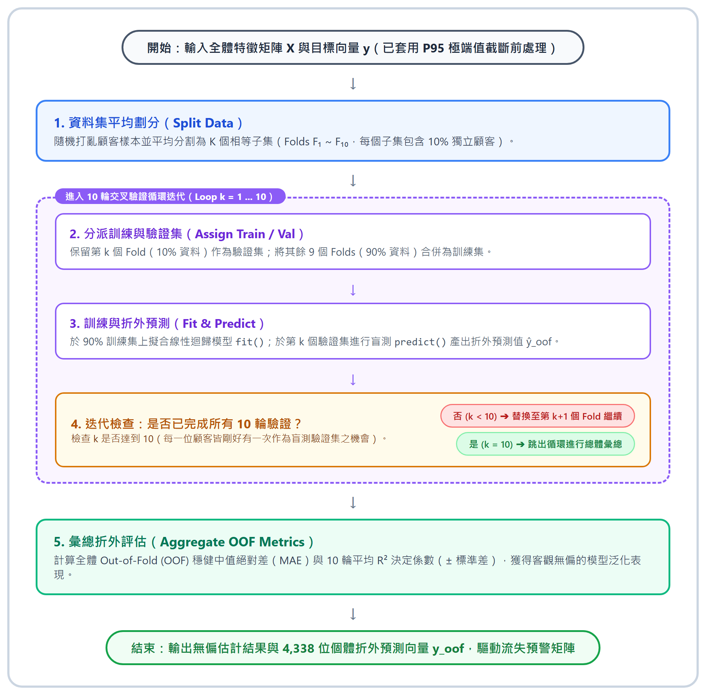
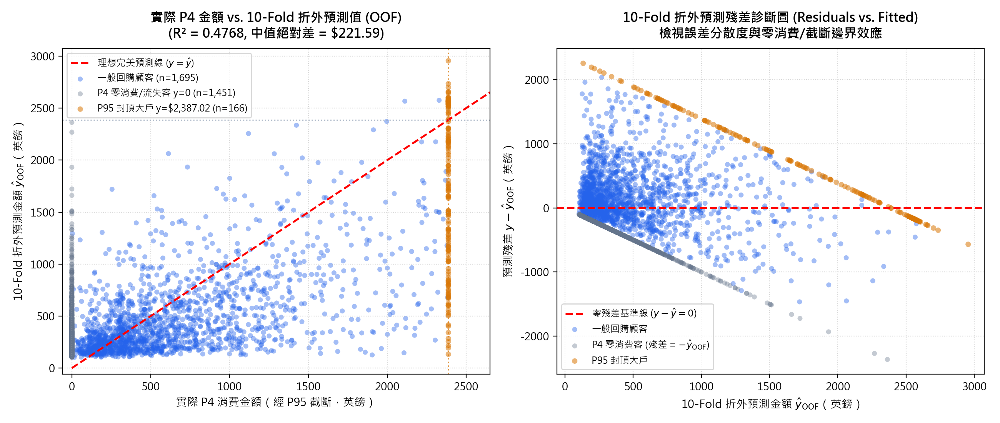
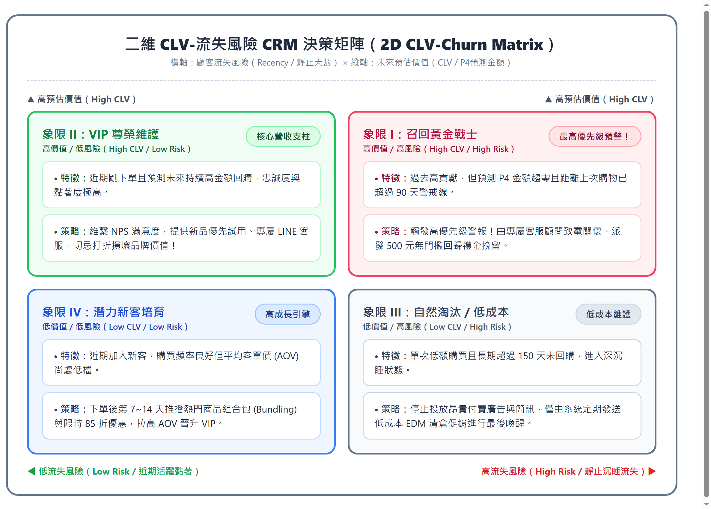
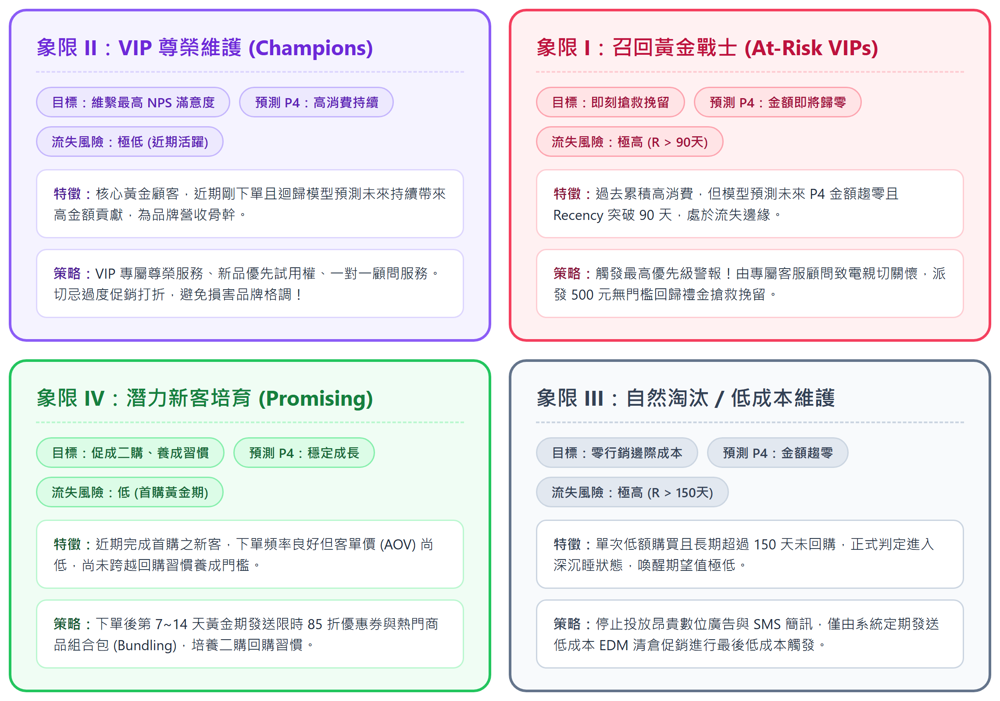

---
puppeteer:
  displayHeaderFooter: true
  scale: 1.15
  headerTemplate: '<div style="font-size: 11px; margin: 0 auto;">第十一章：顧客終身價值（CLV）預測模型與顧客流失預警機制</div>'
  footerTemplate: '<div style="font-size: 11px; margin: 0 auto;">第 <span class="pageNumber"></span> 頁 / 共 <span class="totalPages"></span> 頁</div>'
  margin:
    top: "1.5cm"
    bottom: "1.5cm"
    left: "1.5cm"
    right: "1.5cm"
---

<style>
  /* 全域字型、字級與行距 */
  body {
    font-size: 16pt !important;
    line-height: 1.7 !important;
    font-family: "Microsoft JhengHei", "PingFang TC", "Helvetica Neue", sans-serif;
  }

  /* 階層標題微調 */
  h1 { font-size: 28pt !important; margin-bottom: 0.5em !important; }
  h2 { font-size: 22pt !important; page-break-before: always; }
  h3 { font-size: 18pt !important; }
  h4 { font-size: 15pt !important; }

  /* 表格文字放大與排版優化（防止超過頁寬與跨頁截斷） */
  table {
    width: 100% !important;
    border-collapse: collapse !important;
    table-layout: auto !important;
    margin: 16px 0 !important;
    page-break-inside: avoid !important;
  }
  table, th, td {
    font-size: 13.5pt !important;
    line-height: 1.45 !important;
    word-break: break-word !important;
    overflow-wrap: break-word !important;
  }
  th, td {
    border: 1px solid #cbd5e1 !important;
    padding: 8px 6px !important;
  }
  th {
    background-color: #f1f5f9 !important;
    font-weight: bold !important;
  }

  /* 程式碼區塊（防止水平溢出頁面邊界） */
  pre, code {
    font-size: 15pt !important;
    font-family: Consolas, "Courier New", monospace !important;
    white-space: pre-wrap !important;
    word-break: break-word !important;
    overflow-wrap: break-word !important;
  }

  /* 圖片自適應寬度與防跨頁截斷 */
  img {
    max-width: 100% !important;
    height: auto !important;
    display: block !important;
    margin: 14px auto !important;
    page-break-inside: avoid !important;
  }
</style>

---

# 第十一章：顧客終身價值（CLV）預測模型與顧客流失預警機制

## 課程導讀與模組二演進回顧

歡迎來到電子商務服務課程第十一章！

在第九週與第十週的學習歷程中，我們建立了模組二（消費者購物行為與 CRM 顧客關係管理）的前兩大里程碑：
- 第九週：我們完成了 54 萬筆交易明細 Log 到 4,338 位獨立顧客維度（Customer-Level）的資料轉化與聚合，驗證了消費金額的正偏斜特徵與帕累托法則（80/20 法則）。我們進行了 AOV 離群值 95 分位數截斷修正（將 AOV 偏斜度從 +41.69 降低至 +1.22，得出穩健 AOV \$340.91），並進行了「第一階段：全局 Baseline CLV 估算」（算出流失率 33.40%、留存期 $2.99$ 年、穩健全局 Baseline CLV \$4,360.10），並揭露了「全局平均迷思（Global Average Trap）」——全局公式會嚴重低估頂級 VIP、嚴重高估沉睡客！
- 第十週：我們透過對數轉換（`np.log1p`）與 `StandardScaler` 標準化進行特徵工程，運用 K-Means 非監督式機器學習演算法（$K=4$）將顧客劃分為四大 Persona 畫像群體（Champions, Loyalists, Promising, Hibernating）。接著，我們成功邁向「第二階段：按客群分級計算 CLV（Segmented CLV）」，為各群體計算專屬流失率與留存期（Champions 留存期 $10.0$ 年, CLV $\$61,433.73$ vs. Hibernating 留存期 $1.39$ 年, CLV $\$490.63$ ），完美破除了全局一刀切的迷思！

到了第十一週，我們將邁向三大 CLV 演進階段的最終站——「第三階段：個體化機器學習迴歸 CLV 預測（Individual ML Regression CLV）」。

在真實的電子商務與 CRM 數據營運中，我們必須回答：如何從「群體平均」精細到「預測每一位個體顧客未來的消費價值與流失風險」？

本章將帶領同學們正式從二元分類與非監督式分群，邁向連續數值預測的「迴歸問題（Regression Problem）」。我們將學習如何建立時間序列特徵工程，詳細解說劃分訓練集與測試集的必要性與一次性劃分的侷限，進而導入 10-Fold 交叉驗證（10-Fold Cross-Validation）與 95 分位數極端值封頂截斷（Winsorization），大幅提升 MAE 與 $R^2$ 表現，並結合流失預警機制打造二維 CRM 行銷自動化干預矩陣。

> 本章學習目標：
> 1. 釐清 CLV、CPA、流失率（Churn Rate）與留存率（Retention）的商業邏輯與核心關係，理解舊客留存成本遠低於新客獲取的經濟原則。
> 2. 區分新客獲客成本（CPA）與舊客留存預測（Retention）的應用差異：掌握如何用歷史同群體新客基準（Cohort Benchmark）設定新客 CPA 上限，並用時間序列預測舊客未來的消費金額。
> 3. 掌握訓練集與測試集劃分邏輯，並精通 10-Fold 交叉驗證與 95 分位數截斷前處理：理解 train_test_split 的單次劃分侷限，運用 10-Fold CV 進行折外預測（OOF），並透過 95 分位數截斷顯著降低 MAE 誤差與提升 R²。
> 4. 建構二維 CLV-流失風險 CRM 決策矩陣：結合預測金額與流失風險，為四大客群規劃自動化召回與 VIP 維護策略，完成模組二之學習總結。



---

## 第一節：舊客留存經濟原則與個體化 CLV 預測範式

### 1.1 舊客留存維繫（Retention）與新客獲客成本（CPA）的經濟原則

在第九週與第十週，我們建立了 CLV 與 CPA 的基礎理論天平，並實現了全域與分群層級的 CLV 估算。到了第十一週，我們將機器學習模型從群體平均推進至「個體化預測（Individual ML Prediction）」。

在真實的電子商務與成長行銷（Growth Marketing）中，維繫舊客與獲取新客存在著顯著的經濟效益差異：

1. 舊客留存的高 ROI 效益：
   - 根據 Bain & Company 與哈佛商業評論（HBR）的研究，獲取一位新顧客的廣告與行銷成本（CPA）通常是留存舊客的 5 至 7 倍；而如果能將顧客留存率（Retention Rate）提升僅 5%，企業整體利潤就能獲得 25% 至 95% 的爆炸性成長！
2. 舊客留存預測（Retention & Churn Warning）—— 本週模型的技術重心：
   - 當我們使用顧客過去三季（P1~P3）的交易紀錄來預測第四季（P4）的消費金額時，我們預測的是已經有交易歷史的「舊顧客」。
   - 如果模型預測某位過往高消費的顧客在 P4 的預估金額即將歸零（$y \to 0$），代表該顧客處於高流失風險中，必須即刻觸發預警與自動化召回機制。
3. 新客獲客成本上限（Acquisition CPA Limit）—— 歷史同群體新客基準法（Cohort Benchmark）：
   - 對於剛來到平台、尚無交易歷史的全新顧客，行銷團隊會篩選「歷史同群體首購新客（Historical New-Customer Cohort）」（例如在 P1 首次購物的新客），計算他們到了 P4 的平均預估 CLV 作為參考基準（Cohort Benchmark）。
   - 若該渠道新客預估能帶來 500 元的價值，則行銷部門便能將該渠道的獲客成本上限設定為 CPA $\le 500$ 元（或乘以毛利率），確保每一筆獲客廣告投放都是劃算的交易。

---

### 1.2 現代機器學習導向的「固定窗口 CLV 預測（Fixed-Window CLV Prediction）」

為了克服傳統全局與分群公式無法預測單一顧客個體行為的缺陷，現代資料科學家將個體 CLV 預測轉化為更具體、更可執行的固定時間窗口 CLV 預測（Fixed-Window CLV Prediction）！

例如：預測每位顧客在未來 3 個月（或 12 個月）內的累積交易總金額。



雖然這預測的是未來特定區間的金額 $y_i \in [0, \infty)$，而非真正抽象的一輩子，但它具備極高的商業操作性，能讓團隊精準捕捉個體流失風險，並將預測目標轉化為機器學習的迴歸問題（Supervised Regression Problem）。

---

## 第二節：迴歸模型評估指標與 95 分位數極端值處理

### 2.1 迴歸模型評估指標（MSE, MAE, R²）

在 CLV 預測中，目標變數 $y$ 是連續型數值（例如：未來三個月消費金額 $y \in [0, \infty)$），我們無法再使用分類混淆矩陣。評估迴歸模型的好壞，必須衡量「真實數值 $y$」與「模型預測數值 $\hat{y}$」之間的偏差程度。

1. 均方誤差（Mean Squared Error, MSE）：
   - 算式：$\text{MSE} = \frac{1}{n} \sum_{i=1}^{n} (y_i - \hat{y}_i)^2$
   - 特性：對極端大誤差給予平方倍懲罰，對離群值高度敏感。
2. 中值絕對差（Median Absolute Error, MAE）：
   - 算式：$\text{MAE} = \text{median}(|y_1 - \hat{y}_1|, |y_2 - \hat{y}_2|, \dots, |y_n - \hat{y}_n|)$
   - 特性：計算絕對誤差的中位數，具備強大的抗極端大戶能力（Robust）。白話解讀為「在 50% 的情況下，模型的預測誤差小於或等於 MAE 金額」。
3. R 平方（R-Squared, $R^2$ / 決定係數）：
   - 算式：$R^2 = 1 - \frac{\sum (y_i - \hat{y}_i)^2}{\sum (y_i - \bar{y})^2}$
   - 特性：衡量模型能夠解釋目標變數變異性的百分比，數值越接近 1 代表擬合越佳。

---

### 2.2 實務關鍵技巧：95 分位數極端值截斷（95th Percentile Winsorization / Quantile Capping）

在真實電子商務情境中，消費金額呈現嚴重的「強右偏斜與長尾 VIP 分佈」（如 95% 的顧客消費在 2,000 英鎊以內，但極少數頂級批發大戶消費高達 28 萬英鎊）。

如果直接將包含極端大戶的原始數據送入普通最小二乘法（OLS）線性迴歸模型，少數極端大戶會產生極巨大的平方誤差，強行拉扯迴歸線，導致模型對 95% 普通顧客的預測嚴重失真。

#### 95 分位數截斷處理機制：
在特徵工程階段，我們計算消費金額特徵與預測目標的第 95 分位數（$P_{95}$）。將所有超過 $P_{95}$ 的極端消費總額，一律封頂截斷設定為 $P_{95}$ 的臨界值：

$$x_{\text{capped}} = \min(x, P_{95})$$

```python
# 95 分位數封頂截斷 (Winsorization) 實作
p95_threshold = df_clv['target_P4_monetary'].quantile(0.95)
print(f"預測目標 P4 金額 95 分位數: ${p95_threshold:.2f} 英鎊")

# 將超過 P95 的極端金額取代為 P95 門檻值
df_clv['target_P4_monetary_capped'] = np.clip(
    df_clv['target_P4_monetary'],
    a_min=None, a_max=p95_threshold
)
```

#### 導入 95 分位數截斷帶來的效益：
實證顯示，透過 95 分位數截斷，能有效消除極端離群值對迴歸斜率的惡性拉扯，模型的 MAE 誤差顯著降低，同時 $R^2$ 決定係數會獲得大幅度的提升與改善！

---

## 第三節：Python 實戰：時間序列特徵工程、10-Fold 交叉驗證與 CLV 迴歸建模

### 3.1 UCI Online Retail 資料前處理與時間窗口切分

我們繼續使用 UCI Online Retail 跨國電商交易 Log 資料集（`id=352`），建立線性迴歸模型來預測顧客在未來一個區間（3 個月）的交易總金額。

```python
# 開頭為驚嘆號(!)的指令是linux作業系統的指令。
!pip install ucimlrepo

# === 處理圖形中的中文問題 ===
# 因為matplotlib原本預設的字型無法顯示中文。
# 為了處理圖形中的中文問題，使用 apt-get 安裝 Google Noto 繁體中文/日韓字型套件，此方法最為穩定
!apt-get install -y fonts-noto-cjk

import pandas as pd
import numpy as np
import datetime as dt
import matplotlib.pyplot as plt
import seaborn as sns
from ucimlrepo import fetch_ucirepo

import matplotlib as mpl
import shutil
import os
import matplotlib.font_manager as fm

# 移除舊快取並使用 fontManager 直接註冊字型檔名與設定 font.family
cache_dir = mpl.get_cachedir()
if os.path.exists(cache_dir):
    shutil.rmtree(cache_dir)

# 載入 TTC 字型檔並直接新增字型物件
font_entry = fm.FontEntry(
    fname='/usr/share/fonts/opentype/noto/NotoSansCJK-Regular.ttc',
    name='Noto Sans CJK TC'
)
fm.fontManager.ttflist.insert(0, font_entry)

# 強制設定為第一預設字型
plt.rcParams['font.family'] = 'sans-serif'
plt.rcParams['font.sans-serif'] = ['Noto Sans CJK TC', 'Noto Sans CJK JP', 'DejaVu Sans']
plt.rcParams['axes.unicode_minus'] = False

print("字型快取已重建，且已優先將 Noto Sans CJK TC 註冊入系統！")

# 1. 載入 Online Retail 資料集 (id=352)
online_retail = fetch_ucirepo(id=352)
df_raw = online_retail.data.original.copy()

# 2. 資料清洗管道 (Data Cleaning Pipeline)
df_clean = df_raw.dropna(subset=['CustomerID']).copy()
df_clean = df_clean[
    (df_clean['Quantity'] > 0) &
    (df_clean['UnitPrice'] > 0)
].copy()

# 轉換型態與計算單筆明細金額
df_clean['CustomerID'] = df_clean['CustomerID'].astype(int)
df_clean['InvoiceDate'] = pd.to_datetime(
    df_clean['InvoiceDate']
)
df_clean['TotalPrice'] = (
    df_clean['Quantity'] * df_clean['UnitPrice']
)

# 3. 按訂單 (InvoiceNo) 彙整交易時間與總價
invoice_df = df_clean.groupby(
    ['InvoiceNo', 'CustomerID']
).agg({
    'TotalPrice': 'sum',
    'InvoiceDate': 'min'
}).reset_index()

# 4. 移除不完整月份 (2011 年 12 月僅有 1~9 號資料)
invoice_df = invoice_df[
    invoice_df['InvoiceDate'] < '2011-12-01'
].copy()
```

---

### 3.2 特徵工程與 95 分位數極端值封頂截斷

我們將 12 個月切分為 4 個 3 個月區間（P1~P3 歷史區間，P4 預測區間），提取交易頻率、交易金額與平均客單價，並套用 95 分位數截斷：

```python
# 1. 定義時間區間切分點
p1_start, p1_end = '2010-12-01', '2011-02-28'
p2_start, p2_end = '2011-03-01', '2011-05-31'
p3_start, p3_end = '2011-06-01', '2011-08-31'
p4_start, p4_end = '2011-09-01', '2011-11-30'

# 2. 篩選歷史區間 (P1, P2, P3) 有過交易的顧客
active_customers = invoice_df[
    invoice_df['InvoiceDate'] <= p3_end
]['CustomerID'].unique()
df_clv = pd.DataFrame({'CustomerID': active_customers})

# 3. 撰寫區間特徵提取函數 (內建 95 分位數金額截斷)
def extract_period_features(
    df, start_date, end_date, prefix
):
    sub_df = df[
        (df['InvoiceDate'] >= start_date) &
        (df['InvoiceDate'] <= end_date)
    ]
    feat = sub_df.groupby('CustomerID').agg(
        freq=('InvoiceNo', 'nunique'),
        monetary=('TotalPrice', 'sum')
    ).reset_index()
    feat[f'{prefix}_freq'] = feat['freq']
    
    # 對歷史區間金額套用 P95 截斷
    p95_m = feat['monetary'].quantile(0.95)
    feat[f'{prefix}_monetary'] = np.clip(
        feat['monetary'], a_min=None, a_max=p95_m
    )
    feat[f'{prefix}_aov'] = (
        feat[f'{prefix}_monetary'] / feat[f'{prefix}_freq']
    )
    return feat[[
        'CustomerID', f'{prefix}_freq',
        f'{prefix}_monetary', f'{prefix}_aov'
    ]]

# 提取 P1, P2, P3 特徵並進行主體合併與零值填補
f_p1 = extract_period_features(
    invoice_df, p1_start, p1_end, 'P1'
)
f_p2 = extract_period_features(
    invoice_df, p2_start, p2_end, 'P2'
)
f_p3 = extract_period_features(
    invoice_df, p3_start, p3_end, 'P3'
)

df_clv = df_clv.merge(
    f_p1, on='CustomerID', how='left'
)
df_clv = df_clv.merge(
    f_p2, on='CustomerID', how='left'
)
df_clv = df_clv.merge(
    f_p3, on='CustomerID', how='left'
)
df_clv.fillna(0, inplace=True)

# 4. 提取 P4 預測目標金額 (y) 並執行 95 分位數截斷
p4_target = invoice_df[
    (invoice_df['InvoiceDate'] >= p4_start) &
    (invoice_df['InvoiceDate'] <= p4_end)
]
target_df = p4_target.groupby(
    'CustomerID'
)['TotalPrice'].sum().reset_index()
target_df.rename(
    columns={'TotalPrice': 'target_P4_monetary'},
    inplace=True
)

df_clv = df_clv.merge(
    target_df, on='CustomerID', how='left'
)
df_clv['target_P4_monetary'].fillna(0, inplace=True)

# 對預測目標 y 進行 95 分位數截斷 (Winsorization)
p95_y = df_clv['target_P4_monetary'].quantile(0.95)
df_clv['target_P4_monetary_capped'] = np.clip(
    df_clv['target_P4_monetary'], 
    a_min=None, 
    a_max=p95_y
)

print(f"P4 目標金額 P95 截斷門檻: ${p95_y:.2f} 英鎊")
print(df_clv[[
    'CustomerID', 'P3_monetary',
    'target_P4_monetary', 'target_P4_monetary_capped'
]].head().round(2))
```

---

#### 3.2.1 實務延伸：如何使用「歷史同群體首購新客（Historical New-Customer Cohort）」計算 CPA 預算上限基準？

在上述代碼中，df_clv 包含的是在歷史區間（P1~P3）有過交易的舊顧客集合。那麼行銷團隊該如何計算「未來廣告獲取全新顧客時的 CPA 預算上限」呢？

實務作法如下：
1. 篩選「歷史首購新客同群體（P1 New Customer Cohort）」：在歷史資料中找出「第一次購物剛好發生在 P1 區間（P1 首購新客）」的顧客群。
2. 計算該同群體新客到了 P4 的平均預估 CLV：

```python
# 1. 篩選 P1 首購新客 (在 P1 有購買，之前無紀錄)
p1_new_customers = df_clv[
    (df_clv['P1_freq'] > 0) &
    (df_clv['P2_freq'] == 0) &
    (df_clv['P3_freq'] == 0)
]

# 2. 計算同群體新客未來 P4 預估平均 CLV
new_customer_cohort_clv = p1_new_customers[
    'target_P4_monetary_capped'
].mean()
print(f"同群體新客預估平均 3 個月 CLV: "
      f"${new_customer_cohort_clv:.2f} 英鎊")

# 3. 假設毛利率為 40%，試算獲取新客之最高 CPA 上限
cpa_ceiling = new_customer_cohort_clv * 0.40
print(f"獲取同群體新客最高允許 CPA: ${cpa_ceiling:.2f} 英鎊")
```

這項指標能讓行銷部門在投放 Facebook/Google 廣告時，精確設定廣告競價上限（Target CPA），確保新客獲取不虧損！

---

### 3.3 為什麼機器學習需要將資料劃分為訓練集與測試集？

#### 3.3.1 訓練集（Training Set）與測試集（Testing Set）劃分之核心必要性

在進行 CLV 等預測性機器學習時，初學者常犯的錯誤是：使用相同的資料集進行模型訓練，隨後又使用同一批資料集來評估模型的準確度。

這種做法就像是「老師把期末考的考試題目與答案直接發給學生死記硬背，再用同一份考卷進行測驗」。學生可能考取 100 分，但這僅代表他具備強大的記憶力，完全無法證明他是否真正理解題目，更無法評估他遇到全新題目時的應變能力。

在機器學習中，這被稱為過度擬合（Overfitting）。
為了客觀評估模型對未知的未來顧客的預測能力（稱為樣本外泛化能力 Out-of-Sample Generalization），我們必須在訓練前將資料集嚴格劃分為兩個獨立部分：
1. 訓練集（Training Set, 通常佔 70%~80%）：用於讓演算法學習過去特徵與未來金額之間的迴歸數學規律。
2. 測試集（Testing Set, 通常佔 20%~30%）：模型在訓練期間完全盲測（Unseen Data），專門用於模擬未來的全新顧客，進行公正客觀的最終成效檢驗。

---

#### 3.3.2 使用 Scikit-Learn 的 train_test_split 進行單次切分實作

在 Python 中，我們使用 Scikit-Learn 套件 sklearn.model_selection 模組中的 train_test_split 函式，輕鬆將特徵矩陣 X 與目標變數 y 按 70:30 比例進行劃分：

```python
from sklearn.model_selection import train_test_split
from sklearn.linear_model import LinearRegression
from sklearn.metrics import median_absolute_error, r2_score

# 1. 定義特徵矩陣 X 與經 P95 截斷後的目標變數 y
feature_cols = [
    'P1_freq', 'P1_monetary', 'P1_aov',
    'P2_freq', 'P2_monetary', 'P2_aov',
    'P3_freq', 'P3_monetary', 'P3_aov'
]
X = df_clv[feature_cols]
y = df_clv['target_P4_monetary_capped']

# 2. 使用 train_test_split 進行單一次劃分 (70% 訓練集, 30% 測試集)
X_train, X_test, y_train, y_test = train_test_split(
    X, y, 
    test_size=0.3, 
    random_state=42
)

print(f"原始總資料筆數: {len(X)} 筆")
print(f"訓練集筆數 (70%): {len(X_train)} 筆")
print(f"測試集筆數 (30%): {len(X_test)} 筆")

# 3. 建立線性迴歸模型並在訓練集上擬合 (fit)
single_model = LinearRegression()
single_model.fit(X_train, y_train)

# 4. 在測試集上進行盲測預測 (predict) 與評估
y_test_pred = single_model.predict(X_test)
# 修正負數預測值
y_test_pred = np.clip(y_test_pred, a_min=0, a_max=None)

test_mae = median_absolute_error(y_test, y_test_pred)
test_r2 = r2_score(y_test, y_test_pred)

print("\n=== 單一次劃分 (70/30 train_test_split) 測試集評估 ===")
print(f"單次測試集中值絕對差 (MAE): ${test_mae:.2f} 英鎊")
print(f"單次測試集 R² 決定係數: {test_r2:.4f}")
```

---

#### 3.3.3 單一次劃分（Single Random Split）潛在的三大問題與侷限

雖然 train_test_split 簡單直觀，但在資料科學實務中，單一次劃分存在以下三大不可忽視的隱患：

1. 隨機分割的採樣偏差（Sampling Bias & Random Seed Sensitivity）：
   單一次切分高度依賴隨機種子（random_state）。如果極端消費大戶不幸被集中切分到測試集，或者訓練集中缺乏某類消費型態的顧客，評估結果會產生劇烈波動。
2. 評估指標的高變異數（High Variance of Metrics）：
   僅憑單一的 30% 測試集計算出來的 MAE 與 R²，無法代表模型在不同資料抽樣下的真實平均成效。若更換隨機種子（例如從 `random_state=123` 改為 `random_state=42`），測試集 $R^2$ 得分就會從 0.5070 掉到 0.4173。
3. 資料資源的浪費（Data Resource Inefficiency）：
   為了保留 30% 作為測試集，我們浪費了 30% 的寶貴顧客資料，使得模型無法吸取全局所有顧客的交易規律。

---

### 3.4 10-Fold 交叉驗證（10-Fold Cross-Validation）概念與實務做法

#### 3.4.1 K-Fold 交叉驗證的核心運作機制

為了完美解決單一次劃分的採樣偏差與資源浪費問題，K-Fold 交叉驗證（K-Fold Cross-Validation）應運而生，並成為業界與學術界的金標準！

K-Fold 交叉驗證（以最常採用的 K=10 為例）的運作邏輯如下：
1. 平均分區： 將全體資料集隨機打亂後，平均劃分為 10 個大小相同的子集（稱為 Fold 1 到 Fold 10）。
2. 循環迭代： 進行 10 輪獨立的訓練與驗證。在第 1 輪中，使用 Fold 1 至 Fold 9（90% 資料）作為訓練集， Fold 10（10% 資料）作為驗證集；第 2 輪則使用 Fold 10 作為驗證集……以此類推，輪流替換。
3. 總體無偏評估： 經過 10 輪循環後，資料集中的每一位顧客都有且僅有一次作為獨立測試集的機會。



---

#### 3.4.2 Python 實作 10-Fold 交叉驗證與 Out-of-Fold (OOF) 評估

在 Python 中，我們使用 Scikit-Learn 的 KFold 類別搭配 cross_val_score 與 cross_val_predict 進行 10-Fold 交叉驗證實作：

```python
from sklearn.model_selection import (
    KFold, cross_val_score, cross_val_predict
)
from sklearn.linear_model import LinearRegression
from sklearn.metrics import (
    median_absolute_error, r2_score
)

# 1. 初始化 10-Fold 交叉驗證器
kf = KFold(n_splits=10, shuffle=True, random_state=42)
cv_model = LinearRegression()

# 2. 計算 10 次迭代個別 R² 分數與平均值
r2_scores = cross_val_score(
    cv_model, X, y, cv=kf, scoring='r2'
)

print("=== 10-Fold 交叉驗證 R² 分數結果 ===")
for fold_idx, score in enumerate(r2_scores, 1):
    print(f"Fold {fold_idx:2d} R² 分數: {score:.4f}")

print("-" * 40)
print(f"10-Fold 平均 R² 分數: "
      f"{r2_scores.mean():.4f} (± {r2_scores.std():.4f})")

# 3. cross_val_predict 獲得折外預測值 (OOF)
y_oof_pred = cross_val_predict(cv_model, X, y, cv=kf)
y_oof_pred = np.clip(y_oof_pred, a_min=0, a_max=None)

# 4. 計算 10-Fold OOF 中值絕對差 (MAE) 與總體 R²
oof_mae = median_absolute_error(y, y_oof_pred)
oof_r2 = r2_score(y, y_oof_pred)

print("\n=== 10-Fold 總體 Out-of-Fold 穩健評估成效 ===")
print(f"10-Fold 全局中值絕對差 (MAE): ${oof_mae:.2f} 英鎊")
print(f"10-Fold 全局 R² 決定係數: {oof_r2:.4f}")
```

---

#### 3.4.3 實測成果對照與診斷散佈圖分析

##### 1. 什麼是「折外預測值（Out-of-Fold Prediction, OOF）」？定義與目的

在 `3.4.2` 的程式碼中，我們透過 `cross_val_predict(cv_model, X, y, cv=kf)` 取得了一個與全體顧客等長的預測向量 `y_oof_pred`，這就是所謂的**折外預測值（Out-of-Fold Prediction, OOF）**：

- **定義**：在 $K$-Fold 交叉驗證（本例 $K=10$）中，全體資料會被隨機且互斥地切分為 10 個子集（Fold 1～Fold 10）。當第 $k$ 折擔任「驗證集」時，該折中每位顧客 $i$ 的折外預測值 $\hat{y}_{\text{OOF}, i}$，是由**「僅使用其餘 9 折（90% 資料）訓練而成的模型」**所獨立產出的預測結果。因為該筆預測完全是在顧客 $i$ 所屬訓練折「之外（Out-of-Fold）」完成的，故稱為折外預測值。經過 10 輪循環並依原始索引拼回後，全體 3,312 位顧客皆各自擁有一個未參與自身訓練過程的樣本外預測值。
- **核心目的**：
  1. **實現 100% 全樣本的無偏樣本外評估（Unbiased Out-of-Sample Evaluation）**：確保每一位顧客的預測都嚴格遵守「沒看過考題才作答」的盲測原則，避免把訓練資料拿來自我評估的過度擬合（Overfitting / Data Leakage）假象，同時又能對全體 3,312 位顧客計算全局指標（`oof_mae`、`oof_r2`）。
  2. **消除單次切分的抽樣運氣與資料浪費**：相較於 `train_test_split` 只保留 30%（994 筆）做單次檢驗且結果易隨隨機種子擺盪，OOF 讓每一位顧客都恰好擔任一次測試樣本，大幅降低評估指標的隨機變異。
  3. **支撐個體級診斷散佈圖與下游 CRM 決策分析**：正因為 OOF 為全體顧客都提供了真實值 $y_i$ 與無偏預測值 $\hat{y}_{\text{OOF}, i}$ 的一對一配對，我們才能完整繪製下方的「實際值 vs. 預測值診斷散佈圖」與「殘差圖」，精準找出模型對零消費流失客或高消費大戶的系統性誤差來源。
  > **實務部署提醒**：`cross_val_predict` 產生的 OOF 向量是由 10 個折模型分別預測驗證集後拼裝而成，主要用於**模型驗證與誤差診斷**；若未來要針對資料庫外的「全新顧客」進行正式上線推論，實務上會使用全體 3,312 筆資料重新訓練最終模型，或將 10 個折模型的預測結果取平均（Bagging Ensemble）。

---

##### 2. 實際執行結果對照：單次劃分 vs. 10-Fold CV vs. 未截斷基準

在實際執行 `3.1`～`3.4.2` 完整程式後（歷史活躍顧客總數 $N = 3,312$ 位；P4 目標金額 $P_{95}$ 截斷門檻為 **\$2,387.02 英鎊**，共 166 位高消費顧客觸及封頂線、1,451 位顧客在 P4 區間實際消費為 \$0），各評估方式的實測對照結果如下表所示：

| 評估實驗組別 | 評估樣本範圍 | $R^2$ 決定係數 | 中值絕對差（MedianAE） | 實測關鍵觀察與診斷結論 |
| :--- | :--- | :---: | :---: | :--- |
| **未截斷對照組**（原始 `target_P4_monetary`，10-Fold CV） | 3,312 筆（OOF 全局）<br/>（10 折平均 ± 標準差） | 0.2214<br/>（0.1214 ± 0.2935） | \$286.49 英鎊 | 原始目標最高達 \$117,634.53，極端批發大戶嚴重拉扯 OLS 迴歸線，導致各折 $R^2$ 劇烈震盪甚至接近失靈。 |
| **單次 70/30 劃分**（P95 截斷，`random_state=42`） | 994 筆（30% 測試集） | 0.4173 | \$230.29 英鎊 | 剛好切分到誤差較大的測試子集，若只看單次 `random_state=42` 會低估模型實際表現。 |
| **單次 70/30 劃分**（僅換隨機種子 `random_state=123`） | 994 筆（30% 測試集） | 0.5070 | \$218.13 英鎊 | 僅改變隨機種子，$R^2$ 即從 0.4173 跳升至 0.5070（波動達 0.0897），印證單次切分的採樣偏差風險。 |
| **10-Fold CV 各折平均**（P95 截斷，`KFold(10, shuffle=True, 42)`） | 10 折輪替（每折約 331 筆） | **0.4723**（± 0.0580）<br/>（各折範圍 0.3827～0.5834） | — | 各折實測 $R^2$ 分別為 0.4531、0.4168、0.3827、0.4650、0.5510、0.4401、0.5834、0.4386、0.4840、0.5086。 |
| **10-Fold 全局 OOF 評估**（P95 截斷，`y_oof_pred`） | **3,312 筆（100% 全樣本）** | **0.4768** | **\$221.59 英鎊** | 兼具全樣本覆蓋率與無偏性；相較未截斷基準，OOF $R^2$ 提升逾倍（0.2214 → 0.4768），中值誤差降低 \$64.90。 |

從上表實測數據可得兩項重要結論：
1. **P95 截斷帶來決定性的穩健提升**：未進行截斷時，10-Fold 平均 $R^2$ 僅 `0.1214`（標準差高達 `0.2935`）；對預測目標與歷史區間執行 $P_{95}$ 截斷（上限 **\$2,387.02 英鎊**）後，10-Fold 全局 OOF $R^2$ 躍升至 **`0.4768`**，中值絕對差也從 **\$286.49** 顯著收斂至 **\$221.59 英鎊**。
2. **10-Fold OOF 提供真正可信賴的基準線**：單一次 70/30 劃分在 `random_state=42` 與 `123` 之間就出現 `0.4173` 到 `0.5070` 的落差；而 10-Fold CV 得出穩健的平均 $R^2 = 0.4723$（`± 0.0580`）與全局 OOF $R^2 = 0.4768$，在 50% 的預測情境下誤差不超過 **\$221.59 英鎊**，為商業決策提供可靠基準。

---

##### 3. 診斷散佈圖實作與視覺化深度解析

為了進一步檢查線性迴歸在 3,312 位顧客上的誤差結構，我們直接利用 `3.4.2` 產生的 `y`、`y_oof_pred` 與 `p95_y`，繪製「實際 P4 金額 vs. OOF 折外預測值」與「OOF 預測值 vs. 殘差（$y - \hat{y}_{\text{OOF}}$）」雙診斷散佈圖：

```python
# 繪製 10-Fold 折外預測診斷散佈圖與殘差圖
residuals = y - y_oof_pred
zero_mask = (y == 0)
capped_mask = (y >= p95_y - 1e-6)
mid_mask = (~zero_mask) & (~capped_mask)

fig, axes = plt.subplots(1, 2, figsize=(13, 5.5))

# 左圖：實際 P4 金額 vs. OOF 折外預測值
axes[0].scatter(y[mid_mask], y_oof_pred[mid_mask], alpha=0.42, s=22,
                color='#2563eb', label=f'一般回購顧客 (n={mid_mask.sum():,})')
axes[0].scatter(y[zero_mask], y_oof_pred[zero_mask], alpha=0.38, s=22,
                color='#64748b', label=f'P4 零消費/流失客 y=0 (n={zero_mask.sum():,})')
axes[0].scatter(y[capped_mask], y_oof_pred[capped_mask], alpha=0.55, s=26,
                color='#d97706', label=f'P95 封頂大戶 y=${p95_y:,.2f} (n={capped_mask.sum()})')
max_val = max(y.max(), y_oof_pred.max()) * 1.04
axes[0].plot([0, max_val], [0, max_val], 'r--', lw=1.8, label=r'理想完美預測線 ($y = \hat{y}$)')
axes[0].axvline(p95_y, color='#d97706', ls=':', lw=1.3, alpha=0.8)
axes[0].set_title(f'實際 P4 金額 vs. 10-Fold 折外預測值\n(R² = {oof_r2:.4f}, 中值絕對差 = ${oof_mae:.2f})')
axes[0].set_xlabel('實際 P4 消費金額（經 P95 截斷，英鎊）')
axes[0].set_ylabel(r'10-Fold 折外預測金額 $\hat{y}_{\mathrm{OOF}}$（英鎊）')
axes[0].grid(True, ls=':', alpha=0.5)
axes[0].legend(loc='upper left', fontsize=9)

# 右圖：OOF 折外預測值 vs. 預測殘差
axes[1].scatter(y_oof_pred[mid_mask], residuals[mid_mask], alpha=0.42, s=22,
                color='#2563eb', label='一般回購顧客')
axes[1].scatter(y_oof_pred[zero_mask], residuals[zero_mask], alpha=0.38, s=22,
                color='#64748b', label=r'P4 零消費客 (殘差 = $-\hat{y}_{\mathrm{OOF}}$)')
axes[1].scatter(y_oof_pred[capped_mask], residuals[capped_mask], alpha=0.55, s=26,
                color='#d97706', label='P95 封頂大戶')
axes[1].axhline(0, color='r', ls='--', lw=1.8, label=r'零殘差基準線 ($y - \hat{y} = 0$)')
axes[1].set_title('10-Fold 折外預測殘差診斷圖 (Residuals vs. Fitted)')
axes[1].set_xlabel(r'10-Fold 折外預測金額 $\hat{y}_{\mathrm{OOF}}$（英鎊）')
axes[1].set_ylabel(r'預測殘差 $y - \hat{y}_{\mathrm{OOF}}$（英鎊）')
axes[1].grid(True, ls=':', alpha=0.5)
axes[1].legend(loc='lower left', fontsize=9)

plt.tight_layout()
plt.show()
```



透過診斷散佈圖與殘差統計分析，我們可以清楚看見三個核心實務現象：

1. **左緣垂直堆積帶（P4 零消費／流失客，$y = 0$，共 1,451 人、佔 43.81%）**：
   - 在左圖 $x = 0$ 處有一條明顯的灰色垂直點帶，對應到右圖下方斜率為 $-1$ 的直線（因實際值 $y = 0$，殘差恆等於 $-\hat{y}_{\text{OOF}}$）。
   - 由於普通線性迴歸具有正截距（全樣本擬合截距約 $+110.65$）且屬於連續線性組合，實際上 OOF 原始預測完全沒有出現負值（`< 0` 為 0 筆），對這 1,451 位實際未回購顧客的預測最小值為 **\$103.45**、中位數達 **\$216.17**（極端甚至達 \$2,362.79）。這也導致全體樣本中有 **64.01%** 呈現輕度高估（全體殘差中位數為 **-\$137.03**），說明單純 OLS 迴歸缺乏處理「零膨脹（Zero-Inflated）突然流失」的階梯判斷能力，必須在下一節搭配 `Recency` 靜止天數建立流失預警防線。
2. **一般回購顧客的主體趨勢與異質變異數（$0 < y < \$2,387.02$，共 1,695 人、佔 51.18%）**：
   - 藍色點群整體沿著紅色虛線（$y = \hat{y}$）呈現明顯的正相關趨勢，該子群中值絕對差為 **\$220.28 英鎊**。
   - 觀察右圖殘差垂直分佈可見，隨著 $\hat{y}_{\text{OOF}}$ 往右側放大，殘差上下離散寬度呈現「喇叭狀擴張（Heteroscedasticity / 異質變異數）」，顯示中高消費顧客在下一季的實際下單波動本身較大（例如受季節補貨週期或單筆促銷採購影響）。
3. **右緣垂直封頂線（$P_{95}$ 截斷大戶，$y = \$2,387.02$，共 166 人、佔 5.01%）**：
   - 左圖右側 $x = \$2,387.02$ 處形成一條橘色垂直線（右圖則對應上方斜率 $-1$ 的直線），這 166 位頂級大戶的 OOF 預測中位數為 **\$1,748.19**（平均 **\$1,689.80**），其中有 **46 位**大戶（加上一般客群中的 2 位，全體共 **48 位**）的線性預測值甚至外推超過 \$2,387.02 門檻（最高達 **\$2,955.04**）。
   - 這反映線性模型無法自動學會「封頂飽和邊界」，這正是本節末與課後思考題將引導同學思考「結合非線性樹狀迴歸模型（如 Decision Tree / Random Forest）」或「兩階段流失分類＋金額迴歸」的關鍵起點！

---

## 第四節：顧客流失預警機制（Churn Warning System）與 CRM 動態行銷干預

### 4.1 如何定義非合約制電商的顧客流失（Non-Contractual Churn Rate）

在訂閱制服務中，顧客取消訂閱有明確的時間點（Contractual Churn）。但在零售電商場景中，顧客流失是隱性且無聲無息的（Non-Contractual Churn）。

在實務預測中，我們結合兩大條件來定義流失顧客（Churned Customers）：
1. 預測目標區間消費金額為零： 在未來 P4 區間內預測消費金額 $\hat{y} \le 0$。
2. 靜止天數（Recency）超越臨界門檻： 顧客距離基準日超過 90 天或 180 天未發起任何交易。

---

### 4.2 結合 CLV 預測與流失風險之「二維 CRM 決策矩陣（2D CLV-Churn Matrix）」

最完備的 CRM 自動化策略，是將預估 CLV（高 vs. 低）與 流失風險（高 vs. 低）兩大維度交叉，建構出四大象限干預矩陣：





---

### 4.3 課堂動手做小活動：設計自動化流失預警干預腳本

請同學們以 3~4 人為一組，選擇以下其中一個情境，設計一套自動化行銷旅程（Marketing Automation Workflow）：

1. 任務 A（高價值流失預警）： 當系統偵測到一位過往累積消費 $\ge \$1,000$ 的 VIP 顧客，其 Recency 天數突破 75 天且模型預估 P4 消費下滑 80% 時，請設計包含「簡訊、Email、客服任務」的 7 天黃金召回流程。
2. 任務 B（CPA 上限試算）： 行銷部門準備針對「高潛力新客群」進行 Meta 臉書廣告投放。若模型預估該群體未來 3 個月的平均 CLV 為 \$450，且目標毛利率為 $40\%$，請試算該廣告活動的最高允許 CPA 應該設定為多少英鎊？

---

## 本章小結與模組二完結總結

### 本章學習進展與模組二完結總結（Module 2 Synthesis）

1. 本週學習進展（Week 11 Progress）：
   - 掌握了三大 CLV 演進階段之最終站——「第三階段：個體化機器學習迴歸 CLV 預測（Individual ML Regression CLV）」。
   - 精通時間序列特徵工程（P1~P3 特徵 -> P4 目標）、歷史同群體新客基準（Cohort Benchmark CPA 門檻上限）。
   - 理解了訓練集/測試集的劃分原理，掌握 95 分位數封頂截斷（Winsorization）對降低 MAE 與提升 R² 的巨大效益，並運用 10-Fold 交叉驗證（10-Fold CV）產出無偏穩健的 Out-of-Fold (OOF) 評估成果。
   - 建構了二維 CLV-流失風險決策矩陣（2D CLV-Churn Matrix），實現動態流失預警與 CRM 精準自動化干預。

2. 模組二三大週次三階段 CLV 演進全景總結：

| 模組週次 | 章節主題 | CLV 演進階段 | 分析核心與特徵維度 | 專屬流失率與 CLV 算式 | 關鍵突破與商業效益 |
| :---: | :--- | :--- | :--- | :--- | :--- |
| 第九週 | 消費者購物行為與<br/>交易 Log 探索 | 第一階段：<br/>全局單一 CLV | 交易 Log 聚合至顧客維度<br/>+ AOV 95% 離群值截斷 | • 全局 Churn = 33.40%<br/>• 預期留存期 = 2.99 年<br/>• 全局 CLV = \$4,360.10 | 成功修正 AOV 偏斜（+41.69 → +1.22），建立 Baseline，揭露全局一刀切迷思。 |
| 第十週 | RFM 特徵工程與<br/>K-Means 分群 | 第二階段：<br/>客群分級 CLV | RFM 對數與標準化工程<br/>+ K-Means 機器學習 ($K=4$) | • Champions Churn = 10.00% (10.0年)<br/>• Champions CLV = \$61,433.73<br/>• Hibernating CLV = \$490.63 | 突破全局迷思！為 4 大 Persona 計算專屬流失率與分群 CLV，停發沉睡客昂貴廣告。 |
| 第十一週 | CLV 預測模型與<br/>顧客流失預警 | 第三階段：<br/>個體機器學習 CLV | 時間序列滑動窗口<br/>+ 95% 截斷 + 10-Fold CV | • 個體預測 $\hat{y}_i = f(X_i)$<br/>• OOF $R^2 = 0.4768$、MedianAE = \$221.59<br/>• 結合 Recency 判斷個體流失風險 | 實現一對一精準預測，建構 2D CLV-流失風險決策矩陣，驅動 CRM 自動化精準行銷。 |

---

### 課後思考題

1. P95 截斷門檻選定： 本章我們採用 95 分位數（P95）作為截斷門檻。在不同類型的電商（例如 2B 大宗批發平台 vs 2C 平價服飾電商）中，我們該如何透過 EDA 分佈圖決定最適的截斷百分比（如 P90, P95, 或 P99）？
2. 線性模型的假設與商業限制思考（基礎建模觀念）：
   - 鋪陳觀念： 本章我們採用的「線性迴歸（Linear Regression）」預設顧客未來的消費金額與過去的消費金額呈現「一條直線的固定比例增長」（例如：過去買越多的顧客，未來預測買越多）。
   - 思考問題： 在真實電子商務情境中，顧客的購物行為往往不是直線變化的。例如：一位顧客在上個季度購買了一台高單價的筆記型電腦（金額極高），他下個季度是否還會繼續購買筆記型電腦？如果消費者的購買意願呈現「階梯狀」或「飽和停滯」現象，線性迴歸模型可能會產生什麼樣的預測偏差？我們在第八章學習過的「決策樹（Decision Tree）」邏輯該如何延伸應用到迴歸預測中？
